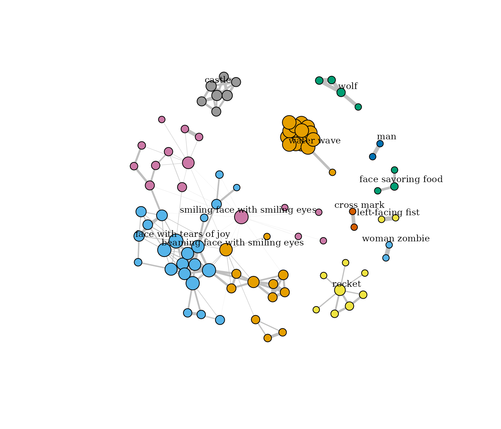

# Emoji networks: edges worth drawing

Which emoji are used together is a network question, and
[`emoji_pairs()`](https://pursuitofdatascience.github.io/tidyEmoji/reference/emoji_pairs.md)
returns exactly the edge list a network package wants. The trap is that
the edge list it returns by default is mostly noise, and a layout draws
noise as confidently as it draws structure. This article builds an emoji
network that is worth drawing: weighted by an association measure,
thresholded on frequency, and checked against what the emoji-network
literature says such networks look like.

``` r

library(tidyEmoji)
library(dplyr)

# the example corpus: 1,485 OASST2 messages, about half carrying emoji
posts <- oasst_messages
```

## Counts first, and why they are not enough

One row per pair of distinct emoji that appear in the same message, with
the number of messages in which they do:

``` r

edges <- posts %>% emoji_pairs(text)
edges
#> # A tibble: 4,316 × 3
#>    item1 item2     n
#>    <chr> <chr> <int>
#>  1 🔬    🚀        4
#>  2 ☀️     ⛅        3
#>  3 ☀️     ⛈️         3
#>  4 ☀️     ❄️         3
#>  5 ☀️     🌊        3
#>  6 ☀️     🌤️         3
#>  7 ☀️     🌥️         3
#>  8 ☀️     🌦️         3
#>  9 ☀️     🌧️         3
#> 10 ☀️     🌨️         3
#> # ℹ 4,306 more rows

edges %>% count(n, name = "pairs")
#> # A tibble: 4 × 2
#>       n pairs
#>   <int> <int>
#> 1     1  4044
#> 2     2   169
#> 3     3   102
#> 4     4     1
```

4044 of the 4316 edges (93.7%) are a single message. A graph drawn from
all of them is one message’s worth of evidence per line, and the few
heavy edges belong to the emoji that are common everywhere, which pair
with everything because they are common, not because they are related.

## Weight by association, then threshold on frequency

Two changes fix this, and they do different jobs.

- **An association measure** scores each pair against what its two
  emoji’s own frequencies predict, so a common emoji no longer wins
  every edge. `measure = "dice"` is `2 * n / (n1 + n2)`, with `n1` and
  `n2` the messages holding each emoji: 1 for a pair never seen apart,
  near 0 for a pair that is mostly apart. `"ppmi"` and `"log_odds"` are
  the alternatives; see
  [`?emoji_pairs`](https://pursuitofdatascience.github.io/tidyEmoji/reference/emoji_pairs.md).
- **A frequency threshold** removes the edges seen too rarely to mean
  anything. An association measure cannot do this on its own: a pair
  seen in one message, whose two emoji appear nowhere else, scores the
  maximum Dice of 1.

``` r

weighted <- posts %>%
  emoji_pairs(text, measure = "dice") %>%
  filter(n >= 2)

weighted
#> # A tibble: 272 × 4
#>    item1 item2     n  dice
#>    <chr> <chr> <int> <dbl>
#>  1 ⛅    ⛈️         3     1
#>  2 ⛅    ❄️         3     1
#>  3 ⛅    🌤️         3     1
#>  4 ⛅    🌥️         3     1
#>  5 ⛅    🌦️         3     1
#>  6 ⛅    🌨️         3     1
#>  7 ⛅    🌩️         3     1
#>  8 ⛅    🌫️         3     1
#>  9 ⛅    🌬️         3     1
#> 10 ⛈️     ❄️         3     1
#> # ℹ 262 more rows
```

That is the honest network for this corpus: 272 edges, where the raw
edge list had 4316. Most of those came from a handful of replies that
tabulate dozens of emoji at once, which pair every emoji in the table
with every other; 1,485 messages holding 1,454 emoji are too few for a
network of more than a modest number of emoji, and it is better to know
that than to draw the whole edge list. A corpus of hundreds of thousands
of messages, or one pooled by user or by conversation with `doc_id`,
gives a graph with real structure.

## Into a network package

The edge list feeds `igraph` (or `tidygraph`) directly, with the
association measure as the edge weight:

``` r

g <- igraph::graph_from_data_frame(
  weighted[, c("item1", "item2", "dice", "n")], directed = FALSE)

igraph::vcount(g)
#> [1] 95
igraph::ecount(g)
#> [1] 272
igraph::components(g)$no
#> [1] 10
```

Community detection then groups emoji that are used together more than
chance; Louvain with the Dice weight is a reasonable default:

``` r

set.seed(2026)   # Louvain breaks ties at random; fix them for a stable answer
communities <- igraph::cluster_louvain(g, weights = igraph::E(g)$dice)
split(igraph::V(g)$name, igraph::membership(communities))
#> $`1`
#>  [1] "⛅" "⛈️"  "❄️"  "🌤️"  "🌥️"  "🌦️"  "🌨️"  "🌩️"  "🌫️"  "🌊" "🌧️"  "🌪️"  "☀️"  "☁️"  "🌈"
#> [16] "🌬️" 
#> 
#> $`2`
#> [1] "🧟‍♀️" "🧟‍♂️"
#> 
#> $`3`
#> [1] "🔴"   "🏡"   "🐺"   "🧒🏻"
#> 
#> $`4`
#> [1] "🤛" "🤜"
#> 
#> $`5`
#> [1] "👨" "👩"
#> 
#> $`6`
#> [1] "❌" "⭕"
#> 
#> $`7`
#>  [1] "🌟" "💖" "✨" "😇" "😎" "🏆" "😉" "👍" "😊" "💃" "😀" "😘" "🤗" "😳" "🙁"
#> 
#> $`8`
#> [1] "👢" "🏰" "👑" "🎩" "🐈" "💰" "🔪"
#> 
#> $`9`
#>  [1] "😖" "😟" "😑" "😩" "😔" "😱" "😲" "😭" "😅" "😁" "🙄" "😈"
#> 
#> $`10`
#>  [1] "😐" "😝" "🤨" "🤩" "😞" "🤪" "😌" "😢" "🤓" "😨" "🤣" "😆" "😜" "😬" "😮"
#> [16] "😂" "😃" "🤔" "😄" "🧐" "🙃" "🤯"
#> 
#> $`11`
#> [1] "😋" "😙" "😣"
#> 
#> $`12`
#> [1] "🌍"   "👨‍💻" "🔬"   "🌐"   "📦"   "💡"   "🚀"   "🤖"
```

Drawing it needs nothing beyond `igraph`’s own
[`plot()`](https://rdrr.io/r/graphics/plot.default.html). The glyphs
draw only where the graphics device has a colour emoji font, so the
labels here are the emoji’s names, given to the best-connected emoji of
each community only so they can be read; the nodes are as large as their
degree, the edges as wide as their Dice association, and the colours are
the communities:

``` r

set.seed(2026)
layout <- igraph::layout_with_fr(g, weights = igraph::E(g)$dice)
deg <- igraph::degree(g)
community <- as.integer(igraph::membership(communities))
top <- deg == stats::ave(deg, community, FUN = max) &
  !duplicated(paste(community, deg))
plot(g, layout = layout,
     vertex.label = ifelse(top, as_emoji_name(igraph::V(g)$name), NA),
     vertex.label.cex = 0.75, vertex.label.color = "black",
     vertex.label.dist = 1,
     vertex.size = 3 + 2 * sqrt(deg),
     vertex.color = community,
     edge.width = 6 * igraph::E(g)$dice, edge.color = "grey75",
     margin = 0)
```



## Sanity checks for a bigger corpus

Studies of emoji co-occurrence networks on large Twitter samples (Fede
et al., 2018; Alsaif et al., 2021) report two properties, and both make
good checks that a network is measuring structure rather than sampling
noise:

- the **degree distribution is heavy-tailed**: a few emoji connect to
  very many, most connect to a few;
- most emoji fall into **a handful of communities**.

Both are one line once the graph exists. On a network of a dozen nodes
they say little; on a real one, a degree table with no tail or a
community count close to the node count is a sign that the threshold was
set too low:

``` r

table(igraph::degree(g))
#> 
#>  1  2  3  4  5  6  7  8  9 10 11 13 14 15 
#> 23 14  7 12  3  5  2  1  4  2  2  3 15  2
length(communities)
#> [1] 12
```

## Directed sequences

`emoji_pairs(directed = TRUE)` orders each pair by first appearance in
the message, so the edge from one emoji to another counts the messages
where the first came first. The same measures apply to that ordered
event, and
[`emoji_ngrams()`](https://pursuitofdatascience.github.io/tidyEmoji/reference/emoji_ngrams.md)
gives the strictly consecutive version for Markov-style models of emoji
sequences.

## References

Alsaif H, Roesch P, Othman S (2021). Analyzing Co-occurrence Networks of
Emojis on Twitter. In *Intelligent Computing*, Springer.
<https://doi.org/10.1007/978-3-030-80126-7_7>

Fede H, Herrera I, Mahdi Seyednezhad SM, Menezes R (2018). Representing
Emoji Usage Using Directed Networks: A Twitter Case Study. In *Complex
Networks & Their Applications VI*.
<https://doi.org/10.1007/978-3-319-72150-7_67>
